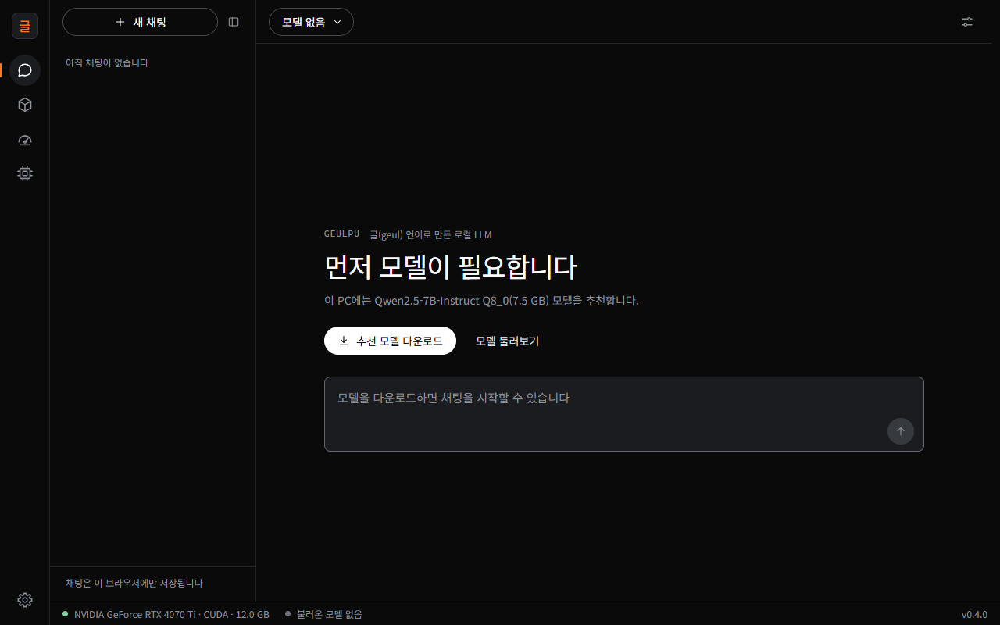
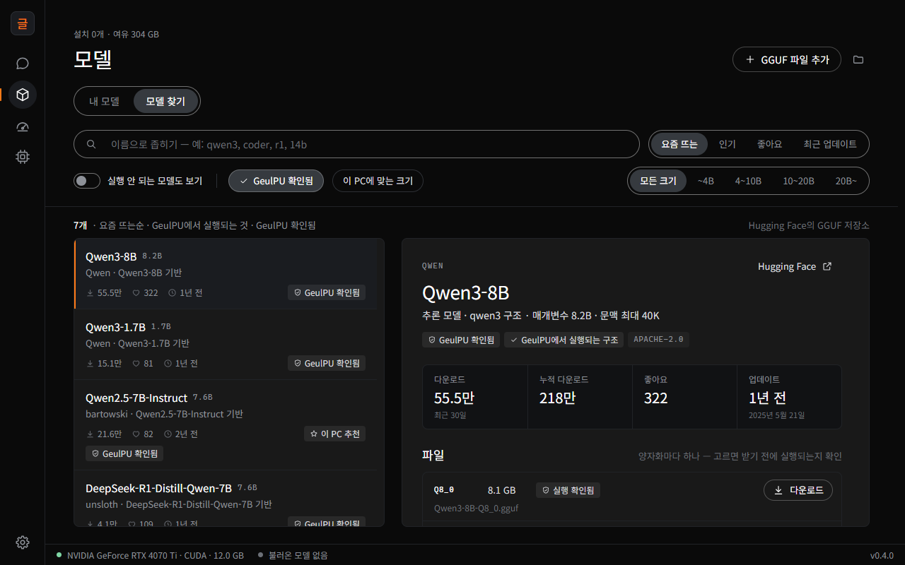
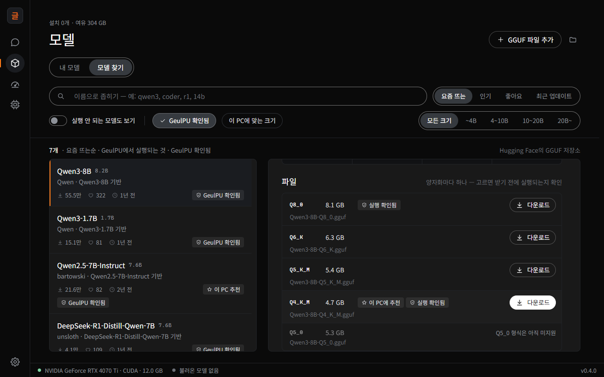
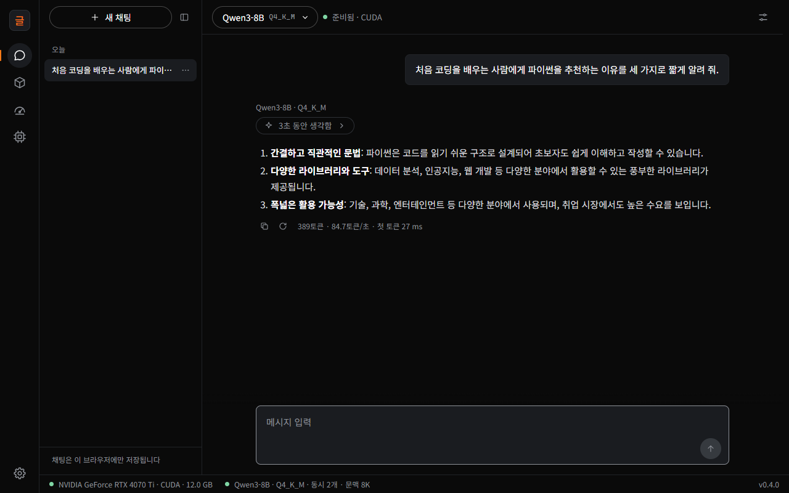
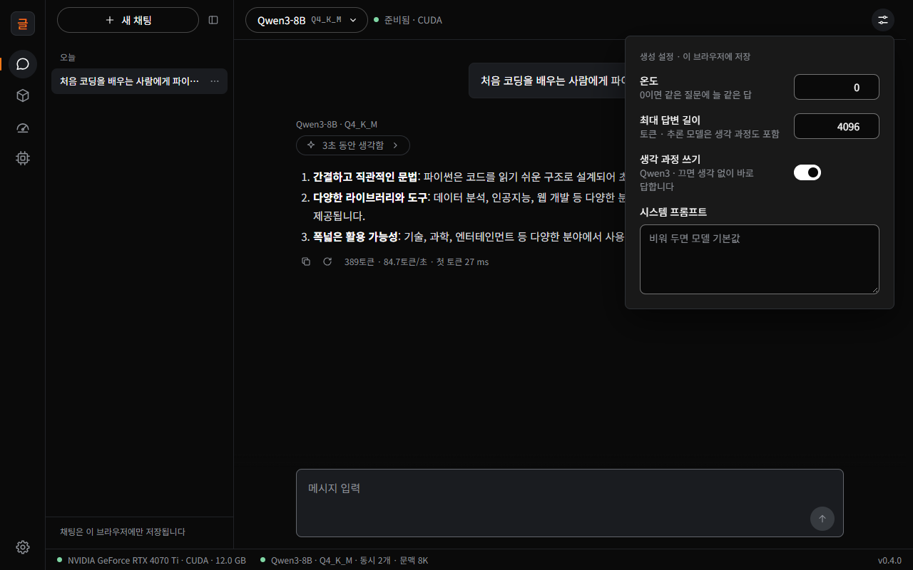
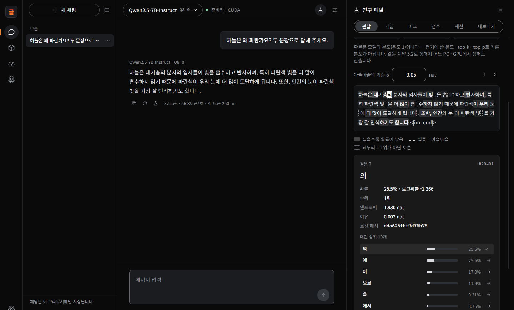
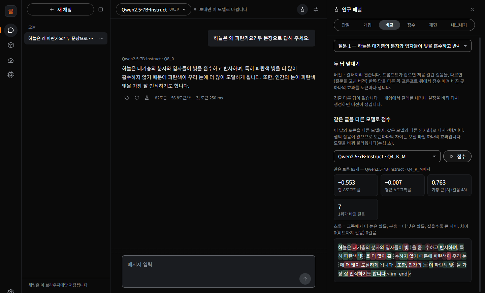
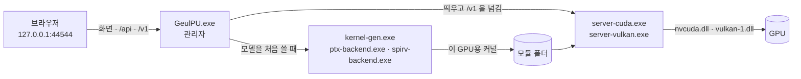

# GeulPU — 내 PC의 그래픽카드로 돌리는 AI 채팅

*English: [README.en.md](README.en.md)*

> 2026-10-16 의 [40단계](문서/40단계.md)에서 계산 손실이 LLM 의 실패 증상(반복 · 엉뚱한 언어 · 깨진 맞춤법 · 틀린 답)을 만드는지 쟀다 —
> 엔진 수준의 손실(llama.cpp · Q8_0)은 답을 거의 다 바꾸지만 증상을 늘리지 않았다. 이 연구는 여기서 멈춘다([방향 전환](문서/방향전환.md)).
> 아래의 앱 안내는 그대로 쓸 수 있다. 논문 초안(영문 · 한국어, PDF): [docs/paper/](docs/paper/) · 원자료(1.7 GB):
> [릴리스 s40-data](https://github.com/wwoosshh/GeulPU/releases/tag/s40-data).

GeulPU는 Qwen3 · Qwen2.5 · DeepSeek-R1 · Llama 3 · Mistral 같은 언어 모델을 **내 PC의 그래픽카드(GPU)에서** 돌리는 Windows 앱입니다. 설치 프로그램 없이
zip을 풀고 `GeulPU.exe`를 실행하면 브라우저에 채팅 화면이 열립니다. 모델은 앱 안에서 Hugging Face로부터 받고, 대화는 이 PC 밖으로
나가지 않습니다.

엔진은 한국어 프로그래밍 언어 **글(geul)** 로 썼습니다 — GPU 커널부터 추론 서버 · 앱까지. CUDA 툴킷 · Python · PyTorch 없이 그래픽
드라이버만으로 돌고, 계산 결과가 CPU 참조 구현과 **비트까지 같도록** 정밀도를 계약으로 정해 둡니다([무엇이 다른가](#무엇이-다른가)).
그래서 같은 글을 다시 셈하면 어느 PC · GPU에서든 같은 확률이 나오고, **연구 패널**에서 토큰마다의 확률을 들여다보고 · 한 토큰을 바꿔
갈래를 내고 · 다른 모델이나 프롬프트와 견주고 · 남의 결과를 비트까지 확인합니다([연구 패널](#5-연구-패널--토큰마다-확률--개입--비교--재현)).

> 적힌 대로만 잃는다. 덜 잃는 데 드는 셈은 숨기지 않는다.

**[⬇ 최신 버전 받기 — Windows 64비트 · zip 약 1.4 MB](https://github.com/wwoosshh/GeulPU/releases/latest)**

[설치](#설치) · [처음 쓰기](#처음-쓰기) · [지원하는 모델](#지원하는-모델) · [실행 방식](#실행-방식) · [문제 해결](#문제-해결) ·
[업데이트 · 삭제](#업데이트--삭제) · [무엇이 다른가](#무엇이-다른가) · [개발 · 연구](#개발--연구)

## 설치

### 필요한 것

| | |
|---|---|
| 운영체제 | Windows 10 · 11 (64비트) |
| 그래픽카드 | NVIDIA RTX 30 시리즈 이상은 CUDA로, 그 밖의 GPU(AMD Radeon 등)는 Vulkan 1.3으로 돕니다 |
| 그래픽 메모리 | 6 GB부터(작은 모델) — 7B · 8B는 8 GB(Q4_K_M) · 12 GB(Q8_0), 14B는 12 GB 이상([아래 표](#내-pc에-맞는-모델)) |
| 디스크 | 앱 약 5 MB + 모델 하나에 2 ~ 9 GB |
| 인터넷 | 모델을 찾고 받을 때와 새 버전을 확인할 때만 |

그래픽 드라이버는 최신으로 두세요. RTX 20 · GTX 16 이하의 NVIDIA 카드는 CUDA 경로를 쓰지 못합니다(계산 능력 8.0 미만). 이때 앱은 Vulkan으로
돌 수 있는지 스스로 확인합니다. AMD는 Radeon RX 9060 XT에서 확인했습니다.

### 1. 받기

[릴리스 페이지](https://github.com/wwoosshh/GeulPU/releases/latest)에서 **`GeulPU-<버전>-windows-x64.zip`** 을 받습니다. 모델은 들어 있지 않아
작습니다(모델은 앱 안에서 받습니다).

받은 파일이 그대로인지 보려면(선택) 같은 페이지의 `SHA256SUMS.txt` 와 견줍니다. PowerShell에서:

```powershell
Get-FileHash .\GeulPU-0.5.0-windows-x64.zip
```

### 2. 압축 풀기

zip을 마우스 오른쪽 단추로 누르고 **모두 압축 풀기** → 원하는 폴더(예: `C:\GeulPU`)에 풉니다. 경로에 한글이 있어도 됩니다.
zip을 연 채로 그 안의 `GeulPU.exe` 를 바로 실행하지 말고, 꼭 풀어서 실행하세요.

### 3. 실행

`GeulPU.exe` 를 두 번 누릅니다.

1. **"Windows의 PC 보호"** 창이 뜨면 **추가 정보 → 실행**을 누릅니다. 코드 서명을 하지 않은 실행 파일이라 나타납니다. 릴리스 zip은
   GitHub Actions가 이 저장소의 소스로 빌드합니다([실행 방식](#실행-방식)).
2. 검은 창(콘솔)이 하나 뜹니다. 이것이 GeulPU 본체입니다 — **이 창을 닫으면 앱이 꺼집니다.**
3. 브라우저에 `http://127.0.0.1:44544` 가 열립니다. 열리지 않으면 이 주소를 주소창에 직접 입력하세요.

## 처음 쓰기

화면 왼쪽 막대의 아이콘은 위에서부터 **채팅 · 모델 · 벤치마크 · 하드웨어**, 맨 아래가 **설정**입니다. 모델이 하나도 없으면 처음에 이런
화면이 나옵니다. **추천 모델 다운로드**는 이 PC의 그래픽 메모리에 맞춰 고른 모델을 바로 받고, **모델 둘러보기**는 아래의 모델 찾기로 갑니다.



### 1. 모델 받기 — 모델 → 모델 찾기

- Hugging Face의 GGUF 모델이 **요즘 뜨는** 순으로 보입니다. **인기 · 좋아요 · 최근 업데이트** 순으로 바꾸거나, 위 칸에 이름(예: `qwen3`,
  `coder`, `14b`)을 넣어 좁힙니다.
- 기본으로 **GeulPU에서 실행되는 모델만** 보입니다. **실행 안 되는 모델도 보기**를 켜면 모두 보이고, 실행되지 않는 것은 흐리게 까닭과
  함께 보입니다. **이 PC에 맞는 크기**를 켜면 그래픽 메모리에 들어가는 것만 남습니다.
- 처음이라면 **GeulPU 확인됨**을 켜 보세요. GeulPU가 직접 돌려 본 파일이 있는 저장소만 남습니다(아래 그림) —
  [내 PC에 맞는 모델](#내-pc에-맞는-모델).



- 모델을 누르면 오른쪽에 설명 · 다운로드 수 · 라이선스와 **파일 목록**이 나옵니다. 이 PC에 가장 알맞은 파일에는 **이 PC에 추천**,
  GeulPU가 직접 돌려 본 파일에는 **실행 확인됨**이 붙고, 그래픽 메모리에 빠듯하거나 모자라는 파일은 그렇게 표시됩니다. 고른 파일의
  **다운로드**를 누릅니다.



- 받기 전에 파일 앞부분만 읽어 실행되는지 먼저 확인하고, 끊기면 이어서 받고, 다 받으면 SHA-256으로 확인합니다. 받는 중인 파일은
  **내 모델** 칸과 아래 상태 막대에서 보고 멈추거나 이을 수 있습니다.
- 이미 가진 GGUF 파일은 위쪽의 **GGUF 파일 추가**로 넣습니다(파일은 그 자리에 둔 채 씁니다).

### 2. 채팅하기

- 위쪽 모델 단추에서 모델을 고르고 메시지를 보냅니다(**Enter** 보내기 · **Shift+Enter** 줄바꿈).
- **처음 한 번**은 이 GPU와 모델에 맞는 커널을 만들고(빠른 CPU에서 10초 안팎, 느리면 1 ~ 3분) 모델을 그래픽 메모리에 올립니다(7B 약
  20초). 다음부터는 올리기만 합니다.
- **추론 모델**(Qwen3 · DeepSeek-R1)은 답하기 전에 생각을 씁니다. 생각은 'N초 동안 생각함'으로 접혀 있고, 눌러서 펼쳐 봅니다. 답 아래에는
  토큰 수 · 속도(토큰/초)가 나옵니다.



- **Qwen3의 생각 끄기**: 오른쪽 위 **생성 설정**(슬라이더 아이콘) → **생각 과정 쓰기**를 끄면 생각 없이 바로 답합니다.
- **생성 설정**에서 온도(0이면 같은 질문에 늘 같은 답) · 최대 답변 길이 · 시스템 프롬프트도 정합니다(이 브라우저에 저장).



- 답을 다시 생성하거나 내 메시지를 고쳐 보낼 수 있고, 앞의 답은 버전으로 남아 ‹ 1 / 2 › 로 넘겨 봅니다. 코드 · 표 · 수식(LaTeX)을
  그려 줍니다.
- 대화는 이 브라우저에만 저장됩니다.

### 3. 벤치마크 (선택)

- **하드웨어 진단**: 메모리 대역 · 텐서 코어 성능을 재고, 커널마다 하드웨어 한계에 얼마나 가까운지 보여 줍니다.
- **속도 측정**: 프롬프트(512 · 2048 토큰)와 생성 속도(토큰/초).
- **재현성 검증**: DeepSeek-R1-Distill-Qwen-7B Q8_0으로 수학 문제 32개를 풀어 기준 PC의 출력과 비트까지 같은지 견줍니다(빠른 확인은
  문제 2개 · 64토큰).
- 결과는 zip으로 내보낼 수 있습니다(사용자 경로는 지웁니다).

### 4. 설정

GPU 백엔드(자동 · CUDA · Vulkan), Vulkan 장치, 동시 처리 수(동시에 답하는 채팅 수 1 ~ 8)와 채팅마다 문맥 길이, 모델 폴더, 언어, 새 버전
알림. 바꾸면 바로 저장됩니다.

**언어** — 화면은 브라우저 언어를 따릅니다(한국어가 아니면 영어). **설정 → 언어 · Language**에서 자동 · 한국어 · English를 고를 수 있고,
고른 값은 이 브라우저에 저장됩니다.

### 5. 연구 패널 — 토큰마다 확률 · 개입 · 비교 · 재현

GeulPU의 계산은 계약으로 정해져 있어서, 같은 글을 다시 셈하면 생성할 때와 **같은 비트**의 확률이 나옵니다 — 함께 도는 요청 수 · 캐시 ·
GPU · 백엔드(CUDA · Vulkan)와 상관없이. 그래서 두 실행의 차이는 바꾼 것에서만 나옵니다. 채팅 위쪽의 플라스크 단추나 답 아래의 플라스크로
엽니다(이 판에서 받은 답부터 — 연구 기록은 이 브라우저에만).

**처음이면 [연구 패널 안내서](연구자안내.md)부터** — 실험 일곱(망설인 걸음 · 거기서 갈래 · 두 답 비교 · 양자화의 효과 · 낱말 하나의
효과 · 글의 점수 · 재현 캡슐)을 화면 그림과 함께 따라 하고, 숫자 읽는 법과 API 예시까지 담았습니다.

- **관찰** — 답을 토큰으로: 토큰마다 확률 · 순위 · 대안 상위 10 · 엔트로피 · 1위와 2위의 차(여유). 아슬아슬한 걸음(여유 < δ — 셈이나
  설정이 조금만 달라도 다른 토큰이 될 자리)과 1위가 아닌 토큰을 뽑은 걸음을 표시합니다.
- **개입** — 어느 걸음에서 대안 토큰을 골라 **거기서 갈래**: 같은 설정 · 같은 씨앗 · 같은 걸음 번호의 난수로 이어 생성해서 바뀐 것은 고른
  토큰 하나뿐입니다. 온도 · 씨앗 · 최대 길이만 바꿔 다시 생성할 수도 있습니다. 새 답은 버전으로 남습니다.
- **비교** — 두 답(버전 · 갈래)의 처음 갈린 걸음. 질문을 고친 버전이면 같은 답 토큰을 다른 프롬프트로 점수 매겨 토큰마다의 차를,
  같은 글을 다른 모델(예: 같은 모델의 Q8_0 ↔ Q4_K_M)로 점수 매겨 양자화 하나의 효과를 봅니다.
- **점수** — 글을 붙여 넣으면 토큰마다 로그확률과 퍼플렉시티.
- **재현** — 지문(SHA-256 — 셈법은 [계약](문서/계약.md) 5.2), 캐시 없이 다시 돌려 확인, **재현 캡슐**(요청 · 결과 · 로그확률 · 로짓 해시를 JSON 하나로) 내보내기와 불러와
  확인, 엔진 바이너리 · 커널의 해시.
- **내보내기** — 보이는 값 모두 JSON · CSV, 같은 값을 받는 파이썬 코드.

확률은 모델의 분포(온도 1)입니다 — 뽑기에 쓴 온도 · top-k · top-p로 거른 분포가 아닙니다. 패널은 들여다볼 때만 셈하므로 채팅 속도는
그대로입니다.





받은 캡슐은 GPU 없이도 확인합니다 — 저장소를 받아(`pip install numpy`) `python -I 도구/캡슐확인.py <캡슐.json> <모델.gguf>` 를 실행하면
계약의 CPU 참조 구현이 같은 토큰 · 로짓 해시 · 로그확률을 내는지 봅니다(7B는 몇 분).

### 다른 프로그램에서 쓰기 (OpenAI 호환 API)

앱에서 모델을 불러온 상태(채팅을 한 번 보내면 불러옵니다)에서 `http://127.0.0.1:44544/v1` 을 OpenAI 호환 주소로 씁니다. `model` 값은
아무 이름이나 됩니다(지금 불러온 모델이 답합니다). 응답의 `model` 도 보낸 이름 그대로이니, 어느 모델이 답했는지는 `/v1/models` 로 봅니다.

PowerShell 창에 붙여 넣어 실행합니다(한글이 깨지지 않게 응답을 UTF-8로 읽습니다 — `.ps1` 파일로 저장하려면 'UTF-8(BOM)'으로).

```powershell
$body = @{ messages = @(@{ role = 'user'; content = '안녕하세요' }) } | ConvertTo-Json -Depth 4
$r = Invoke-WebRequest -Uri http://127.0.0.1:44544/v1/chat/completions -Method Post -ContentType 'application/json; charset=utf-8' -Body ([Text.Encoding]::UTF8.GetBytes($body)) -UseBasicParsing
([Text.Encoding]::UTF8.GetString($r.RawContentStream.ToArray()) | ConvertFrom-Json).choices[0].message.content
```

```python
from openai import OpenAI   # pip install openai
client = OpenAI(base_url="http://127.0.0.1:44544/v1", api_key="geulpu")   # 키는 아무 글자나
r = client.chat.completions.create(model="geulpu", messages=[{"role": "user", "content": "안녕하세요"}])
print(r.choices[0].message.content)
```

- Qwen3의 생각을 끄려면 요청에 `"chat_template_kwargs": {"enable_thinking": false}` 를 넣습니다(Python은 `extra_body=` 로).
- Qwen3 · DeepSeek-R1의 생각은 기본으로 태그 없이 답 앞에 붙어 옵니다. 요청에 `"geulpu": {"special": true}` 를 넣으면 `<think>` ·
  `</think>` 가 글로 와서 생각과 답을 나눌 수 있습니다.
- 이 PC 안에서만 접속되고 인증은 없습니다. 다른 웹사이트가 브라우저를 통해 보내는 요청은 막습니다.
- `/v1/chat/completions` 는 Qwen2.5 · Qwen3 · Llama 3(3.1 · 3.2) · Mistral(v0.3)의 대화 틀을 씁니다. DeepSeek-R1은 아직 `/v1/completions` 에
  R1의 대화 틀을 직접 넣어 씁니다.
- Llama 3의 틀은 시스템 머리에 날짜를 넣습니다 — 같은 질문이 날마다 다른 프롬프트가 되지 않게 `26 Jul 2024`로 고정하고, 요청의
  `"chat_template_kwargs": {"date_string": "16 Oct 2026"}` 로 바꿉니다. Mistral의 틀에는 시스템 역할이 없어 시스템 말은 첫 질문 앞에
  `{시스템}\n\n` 으로 붙입니다(llama.cpp와 같은 꼴).
- Llama 3 · Mistral은 글 프롬프트(`/v1/completions` 의 글 · `/tokenize` 의 `prompt`)에 BOS를 앞에 붙입니다(llama.cpp · vLLM과 같이 —
  `/tokenize` 는 `"add_special_tokens": false` 면 붙이지 않음). 토큰 번호 프롬프트는 그대로 씁니다.

**로그확률 · 점수 매기기 · 토큰화(연구용)** — 연구 패널의 값은 모두 API로도 받습니다. 값은 계약 5.2([계약](문서/계약.md))로 정해져 어느
PC · GPU에서든 같은 비트입니다.

- `/v1/chat/completions`: `"logprobs": true, "top_logprobs": 5`(0 ~ 20) — OpenAI 꼴(`token` · `logprob` · `bytes` · `top_logprobs`).
- `/v1/completions`: `"logprobs": 5`, `"echo": true`(프롬프트 토큰의 로그확률까지), `"max_tokens": 0`(생성 없이 점수만). `prompt` 는 글이나
  토큰 번호 배열.
- `"geulpu"` 덧붙임: `"logit_hash": true`(걸음마다 로짓 행의 64비트 해시), `"prompt_tokens": true`(채팅 틀을 씌운 프롬프트 토큰),
  `"echo_from": n`(echo 의 로그확률을 번호 n 인 토큰부터 — 0부터 센다, 앞은 null), 응답의 `entropy` · `top_ids` · `top_logprobs`(번호와 나란히) · `seed`.
- `/tokenize` · `/detokenize` · `/tokenizer_info` — vLLM과 같은 꼴.
- `geulpu` 의 `tokens` · `logit_hashes` 는 멈춘 토큰(EOS)을 뽑은 걸음까지 담고, 로그확률 배열(`logprobs` · `entropy` · `top_ids` ·
  `top_logprobs`)은 OpenAI처럼 답 글의 토큰만 담습니다 — 답이 EOS로 끝나면 하나 짧습니다(EOS 걸음의 확률은 `tokens` 를 echo로 점수
  매겨 받습니다). `first_token_ms` 는 이름과 달리 µs입니다(호환을 위해 그대로).
- 생성 중 로그확률을 물으면 토큰당 시간이 약 2% 늘어납니다(7B · 8B — 셈을 다음 걸음의 GPU 셈 뒤에 숨긴다). 묻지 않으면 그대로입니다.

```python
# 글의 토큰마다 로그확률(점수 매기기) — 첫 토큰은 앞 맥락이 없어 null
r = client.completions.create(model="geulpu", prompt="The capital of France is Paris.", echo=True, max_tokens=0, logprobs=5)
print(list(zip(r.choices[0].logprobs.tokens, r.choices[0].logprobs.token_logprobs)))
```

**lm-evaluation-harness** — `local-completions` 로 그대로 붙습니다. 토크나이저는 서버의 것을 써서(`tokenizer_backend=remote`) Hugging Face
토크나이저를 받지 않습니다. 문항마다의 결과는 `num_concurrent` · 동시 처리 수 · CUDA ↔ Vulkan과 상관없이 같은 비트입니다
([38단계](문서/38단계.md)). 동시 처리 수는 **설정**에서 올립니다(최대 8).

```bash
pip install "lm-eval[api]"
lm_eval --model local-completions --tasks arc_easy,gsm8k --model_args model=geulpu,base_url=http://127.0.0.1:44544/v1/completions,tokenizer_backend=remote,tokenized_requests=True,num_concurrent=8
```

## 지원하는 모델

GGUF 파일 하나를 받습니다(여러 조각으로 나뉜 파일은 llama.cpp의 `llama-gguf-split --merge` 로 합쳐서).

| 구조 | 모델 | 크기 |
|---|---|---|
| qwen2 | Qwen2.5-Instruct · Qwen2.5-Coder · DeepSeek-R1-Distill-Qwen과 그 미세조정 모델 | 1.5B 이상(헤드 크기 128) — 7B · 14B를 돌려 봄 |
| qwen3 | Qwen3와 그 미세조정 모델 | 1.7B · 8B · 14B |
| llama | Llama 3.1 · 3.2 Instruct, Mistral 7B Instruct v0.3, 같은 대화 틀을 쓰는 그 미세조정 모델 | 3B · 7B · 8B — 70B는 모양을 합성 모델로 |

- **형식**: Q8_0 · Q4_K_M · Q5_K_M · Q6_K, 그리고 모든 텐서가 Q4_0인 Q4_0 파일.
- **라이선스**: 모델마다 다릅니다. 앱 목록의 Llama 3.1 · 3.2는 Meta의 커뮤니티 라이선스(사용 조건 · 이용 정책 — 월 사용자 7억 명이
  넘는 서비스는 Meta의 허가가 필요), Mistral 7B v0.3 · Qwen2.5 · Qwen3 파일은 Apache 2.0, DeepSeek-R1-Distill은 MIT입니다(앱의 모델 설명에도).
- **아직 안 되는 것**: Gemma · Phi 같은 다른 구조, 질의 폭이 너비와 다른 모델(Qwen3의 0.6B · 4B · 32B, Mistral NeMo), 헤드 크기가 64인
  작은 모델(Qwen2.5-0.5B · Llama 3.2 1B), MoE(Mixtral · Qwen3-30B-A3B 등), Llama 3 · Mistral과 다른 대화 틀(ChatML 등)을 쓰는 llama
  구조 미세조정, 이미지 입력, Q2_K · Q3_K · IQ · Q5_0 · F16 · BF16. 모델 찾기는 이런 파일을 기본으로 숨깁니다.
- **GPU에 따라**: k-양자화(Q4_K_M 등)는 CUDA와, 공유 메모리가 48 KB 이상인 Vulkan GPU에서 돕니다. 윈도의 AMD 드라이버(공유 메모리
  32 KB)에서는 지금 Q8_0(과 Q4_0) 파일만 돕니다.

### 내 PC에 맞는 모델

GeulPU가 직접 돌려 본 파일입니다(앱의 **GeulPU 확인됨**). 크기는 윈도 탐색기와 같은 1024 단위입니다.

| 그래픽 메모리 | 권하는 파일 |
|---|---|
| 6 GB | Qwen3-1.7B Q8_0 (1.7 GB) · Llama-3.2-3B-Instruct Q8_0 (3.2 GB) |
| 8 GB | Qwen3-8B Q4_K_M (4.7 GB) · Qwen2.5-7B-Instruct Q4_K_M (4.4 GB) · DeepSeek-R1-Distill-Qwen-7B Q4_K_M (4.4 GB) · Llama-3.1-8B-Instruct Q4_K_M (4.6 GB) · Mistral-7B-Instruct-v0.3 Q4_K_M (4.1 GB) |
| 12 GB | Qwen3-8B Q8_0 (8.1 GB) · Qwen2.5-7B-Instruct Q8_0 · Qwen2.5-Coder-7B-Instruct Q8_0 · DeepSeek-R1-Distill-Qwen-7B Q8_0 (7.5 GB) · Llama-3.1-8B-Instruct Q8_0 (8.0 GB) · Mistral-7B-Instruct-v0.3 Q8_0 (7.2 GB) — 14B Q4_K_M도 문맥을 줄여 돕니다 |
| 16 GB 이상 | Qwen2.5-14B-Instruct Q4_K_M · DeepSeek-R1-Distill-Qwen-14B Q4_K_M (8.4 GB) |

Qwen3-14B Q4_K_M은 같은 모양의 합성 모델로 출력이 비트까지 맞는지만 확인했고 아직 돌려 보지 않았습니다. 앱은 파일마다 이 PC의 그래픽
메모리에 맞는지 미리 알려 줍니다.

## 실행 방식



1. **관리자**(`GeulPU.exe`)가 `127.0.0.1:44544` 에서 화면을 열고 브라우저를 띄웁니다. 이 PC 안에서만 들리고, 같은 포트에 이미 떠 있으면
   그 화면을 엽니다. 44544는 '글'의 유니코드 번호(U+AE00)입니다.
2. 처음에 GPU를 확인합니다 — NVIDIA RTX 30 이상이면 CUDA(`nvcuda.dll`), 아니면 Vulkan(`vulkan-1.dll`). 설정에서 바꿀 수 있습니다.
3. 모델을 처음 쓸 때 **커널을 만듭니다**. 커널 생성기(`kernel-gen.exe`)가 그 모델의 구조 · 모양 · 형식에 맞는 GPU 커널 소스를 글(geul)로
   쓰고, 글 컴파일러의 뒷단(`ptx-backend.exe` · `spirv-backend.exe`)이 그것을 PTX(NVIDIA) · SPIR-V(Vulkan)로 바꿔 자료 폴더에 둡니다.
   앱 버전마다 한 번입니다.
4. **추론 서버**(`server-cuda.exe` · `server-vulkan.exe`)가 GGUF를 그래픽 메모리에 올리고, 그 커널을 그래픽 드라이버로 바로 돌립니다.
   CUDA 툴킷 · 런타임 · Python이 필요 없습니다.
5. 채팅은 브라우저 → 관리자 → 추론 서버(OpenAI 꼴 API)로 가고, 답은 토큰마다 흘러 돌아옵니다.
6. 검은 창을 닫으면 관리자와 그 아래 프로세스(서버 · 도구)가 함께 꺼집니다.

관리자 · 추론 서버 · 커널 생성기 · 뒷단 모두 글(geul)로 썼고, 가져오는 것은 윈도의 DLL(관리자: kernel32 · ws2_32 · shell32 · winhttp ·
bcrypt · advapi32)과 그래픽 드라이버의 DLL뿐입니다.

**zip 안**

| 파일 | 하는 일 |
|---|---|
| `GeulPU.exe` | 관리자 — 화면, 모델 받기 · 확인, 서버와 도구 띄우기 |
| `bin\server-cuda.exe` · `bin\server-vulkan.exe` | 추론 서버(OpenAI 꼴 HTTP API) |
| `bin\kernel-gen.exe` | 커널 생성기 — 모델 모양에 맞는 커널 소스(글) |
| `bin\ptx-backend.exe` · `bin\spirv-backend.exe` | 글 컴파일러의 뒷단 — 커널을 PTX · SPIR-V로 |
| `bin\device-*.exe` · `bin\diag-*.exe` · `kernels\` | GPU 확인 · 하드웨어 진단 |
| `web\` | 화면(HTML · CSS · JavaScript) |
| `data\` | 받을 수 있는 모델 목록 · 재현성 검증 기준 |
| `version.json` | 버전 · 커밋 · 파일마다 SHA-256 |

**자료 폴더** — `%USERPROFILE%\GeulPU` (버전을 바꿔도 그대로 남습니다)

| | |
|---|---|
| `모델\` | 받은 모델(GGUF) |
| `모듈\<버전>\` | 이 GPU에 맞춰 만든 커널 |
| `결과\` | 벤치마크 결과 |
| `기록\` | 서버 · 작업 기록 — 문제가 생기면 여기를 봅니다 |
| `설정.json` · `모델목록.json` · `허깅목록.json` | 설정 · 내 모델 목록 · Hugging Face에서 고른 파일 |

자료 폴더를 옮기려면 환경 변수 `GEULPU_HOME` 을 두거나 `GeulPU.exe --자료 <폴더>` 로 실행합니다. 그 밖의 실행 옵션은
`--포트 <번호>`(다른 포트) · `--열지않음`(브라우저를 띄우지 않음)입니다.

**네트워크 · 개인정보**

- 관리자와 추론 서버는 `127.0.0.1` 에서만 듣습니다 — 다른 기기에서는 접속할 수 없습니다.
- 인터넷은 세 곳에만 씁니다: 모델 찾기(화면이 Hugging Face API를 직접 읽음), 모델 받기(huggingface.co), 새 버전 확인(GitHub — 설정의 새 버전
  알림으로 끔).
- 사용 통계를 보내지 않습니다. 대화는 브라우저의 저장소에만 남습니다.
- 설치 프로그램이 없고 레지스트리에 쓰지 않습니다.

**빌드 · 신뢰**: 릴리스 zip은 태그를 밀면 GitHub Actions가 이 저장소의 소스로 빌드합니다(`앱/꾸리기.ps1` — 글 컴파일러를 고정점까지 빌드한
뒤 뒷단 · 서버 · 도구 · 관리자). 서버 · 생성기 · 뒷단은 재현성 검증 기준(`교차검증/expected.json`)의 빌드 해시와 같은 바이트인지 확인한 뒤에야
꾸립니다.

## 문제 해결

| 증상 | 할 일 |
|---|---|
| 브라우저가 열리지 않음 | 주소창에 `http://127.0.0.1:44544` 를 직접 입력합니다. |
| "Windows의 PC 보호" | **추가 정보 → 실행**(서명하지 않은 실행 파일). |
| 백신이 실행을 막음 | 풀어 둔 GeulPU 폴더를 예외로 둡니다. 소스와 빌드 과정은 이 저장소에 공개되어 있습니다. |
| 포트 44544를 다른 프로그램이 씀 | `GeulPU.exe --포트 44600` 처럼 다른 포트로 실행합니다. |
| "쓸 수 있는 GPU 없음" | 그래픽 드라이버를 최신으로 올린 뒤 **하드웨어 → 다시 확인**. |
| "이 GPU 미지원" · "그래픽 메모리 부족" | 더 작은 파일(Q4_K_M)이나 작은 모델을 고릅니다. 설정에서 채팅마다 문맥 길이나 동시 처리 수를 줄이면 메모리가 덜 듭니다. |
| 첫 메시지가 오래 걸림 | 처음 한 번은 커널을 만듭니다(1 ~ 3분). 다음부터는 모델을 올리는 시간(수십 초)만 듭니다. |
| 다운로드가 멈춤 | **내 모델** 또는 상태 막대에서 **이어서 다운로드** — 받은 데부터 잇습니다. |
| 그 밖 | `%USERPROFILE%\GeulPU\기록\` 의 기록과 함께 [이슈](https://github.com/wwoosshh/GeulPU/issues)를 남겨 주세요. |

## 업데이트 · 삭제

- **새 버전**: 앱 화면이 GitHub의 새 릴리스를 알려 줍니다. 앱을 끄고 새 zip을 풀어 그 `GeulPU.exe` 를 실행하면 됩니다. 모델 · 설정 · 결과는
  자료 폴더에 그대로 있어 다시 받지 않습니다(커널만 새 버전에 맞춰 한 번 다시 만듭니다). 바뀐 것은 [바뀐것.md](바뀐것.md).
- **삭제**: 앱을 끄고 GeulPU 폴더를 지웁니다. 받은 모델까지 지우려면 `%USERPROFILE%\GeulPU` 도 지웁니다.

## 무엇이 다른가

- **정밀도를 계약으로 밝힌다.** 활성값은 32 개 블록마다 자리 둘(±2¹⁴)의 정수, KV 캐시도 자리 둘 블록 정수, 곱의 합은 정수 텐서
  코어의 정확한 합, 지수 함수는 적어 둔 다항식(적힌지수). 그래서 GPU 의 결과가 CPU 참조 구현([계약/정수계약.py](계약/정수계약.py))과
  **비트까지** 같다. 손실은 모델 파일의 형식(Q8_0 · Q4_0)과 이 계약이 밝힌 만큼뿐이다.
- **어느 길로 계산해도 같은 비트.** 프롬프트를 한 번에 넣든, 나눠 넣든, 하나씩 넣든, 대화로 이어 가든, 여러 문장을 묶든 결과가 같다.
  흔한 엔진(llama.cpp · PyTorch)은 함께 계산하는 양에 따라 결과 비트가 바뀐다. 퍼플렉시티(wikitext-2)도 llama.cpp 는 배치 설정에 따라
  15.8171 ~ 15.8200 으로 바뀌고, 글은 어느 방식으로 넣어도 마지막 비트까지 같다([20단계](문서/20단계.md)). GPU 가 달라도 같다:
  RTX 3080 Ti(Ampere) · RTX 4070 Ti(Ada) · RTX 5070(Blackwell)이 DeepSeek-R1-Distill-Qwen-7B 로 푼 수학 문제 32 개에서 출력과 82,673 걸음의
  로짓까지 비트가 같았고, 회사가 다른 AMD Radeon RX 9060 XT(RDNA4 · Vulkan — 두 PC, 드라이버 두 판)도 NVIDIA 의 CUDA 기준과 82,673 걸음 모두 같았다(같은 조건에서 llama.cpp 는 한 PC 안에서 함께 도는 요청 수만 바꿔도 32 문제의 출력이 모두 갈렸다 — [교차검증](교차검증/)).
  평가 도구도 같다: lm-evaluation-harness 의 문항마다 결과(arc_easy 500 · gsm8k 100)가 동시 요청 1 ↔ 8 · CUDA ↔ Vulkan 에서 모두 같았다
  (같은 설정에서 llama.cpp b11643 은 gsm8k 100 문항 중 41 문항의 생성 글이 동시 요청 수에 따라 달랐다 — [38단계](문서/38단계.md)).
- **숨은 손실이 작다 — 0.5B 에서 잰 값.** Qwen2.5-0.5B-Instruct(Q8_0)의 숨은 손실(같은 가중치의 fp64 참값 대비 KL)이 llama.cpp 의
  1/615(평가글 461 토큰) · 1/385(wikitext-2 148,920 토큰)다. 퍼플렉시티로 보면 글은 참값과 구별되지 않고(상대 −6.6 × 10⁻⁶), llama.cpp 는
  0.34% 높다 — 가중치를 Q8_0 으로 줄인 손실(0.24%)과 같은 급이라 체감할 만큼은 아니다([20단계](문서/20단계.md)). 7B · 14B 는 실제 엔진의
  출력으로 재지 않았다(반올림 자리만 흉내 낸 검토: llama.cpp 식의 1/3805 · 1/4467 — [계약손실검토](문서/계약손실검토.md)).
- **속도 — 생성은 같은 급, 계산이 정하는 프롬프트는 셈이 더 든다.** (RTX 4070 Ti)
  - 생성은 llama.cpp 와 같은 급이다: 7B · 14B 가 0.970 ~ 1.012배 시간(Q8_0 · Q4_0 · k-양자화 — [23](문서/23단계.md) ·
    [24](문서/24단계.md) · [26단계](문서/26단계.md)). 생성은 가중치를 읽는 시간이 정하므로 더 든 셈이 그 뒤에 숨는다.
  - 프롬프트는 짧을 때만 빠르다: 7B Q4_0 이 llama.cpp 최신 공식 릴리스(b11567, 같은 GGUF)의 0.85배(32 토큰) · 1.03배(128) ·
    1.11배(2048) · 1.27배(8192) 시간이고, Q8_0 은 0.85 ~ 1.30배, k-양자화는 0.95 ~ 1.56배다(같은 실행 — [30단계](문서/30단계.md)). 활성값을 자리
    둘(16비트)로 두는 계약이라 같은 최적화라면 행렬곱의 정수 텐서 일이 활성값 8비트인 llama.cpp 의 두 배이고, 어텐션의 정확한 합 ·
    적힌 지수도 셈을 더한다. 길수록 비가 커지는 것은 어텐션의 몫이다.
  - 0.5B(프롬프트 128 ~ 8192 토큰 0.55 ~ 0.82배, 생성 0.63 ~ 0.65배 — [14](문서/14단계.md) · [15단계](문서/15단계.md))와 GPT-2 XL
    (프롬프트 0.78 ~ 0.87배)에서 llama.cpp 보다 빨랐던 것은 커널을 합치고 메가커널로 짠 솜씨의 몫이지, 계약이 공짜라서가 아니다.
  - 같은 최적화에서 계약의 값은 2026-10-13 에 같은 엔진에서 제약을 끄고 쟀다(작업 폴더에서 — 원자료는 저장소에 없다). 타일 판의 활성값
    자리 둘 → 하나: 7B Q4_0 프롬프트 512 · 2048 · 8192 가 1.38 · 1.35 · 1.26 배(하한 — 끝손질과 어텐션의 q 는 자리 둘 그대로). 적힌 지수 →
    근사 지수: 거의 0. 생성은 약 1.0 배(가중치를 읽는 시간이 정한다). 결정성만의 값은 따로 떼어 재지 못했다.
  - 숫자와 재는 법은 [문서/단계기록.md](문서/단계기록.md).

## 개발 · 연구

아래는 엔진을 소스에서 빌드하거나 연구 기록을 보려는 분을 위한 내용입니다. 앱만 쓰려면 위의 [설치](#설치)로 충분합니다.

### 지금 되는 것 · 안 되는 것 (2026-10)

| | |
|---|---|
| 모델 | **Llama-3.1-8B · Llama-3.2-3B · Mistral-7B v0.3**(39단계 — 구조 llama: q · k 줄 되돌리기 · RoPE 늘이기 인자를 계약 4.7 로, 다섯 파일이 CPU 참조와 비트까지 같고 llama.cpp 와 같은 글의 모든 토큰에서 평균 KL 4 × 10⁻⁴ 이하 · 70B 는 모양을 합성 모델로 — [39단계](문서/39단계.md)) · **Qwen3-1.7B · 8B · 14B**(37단계 — 머리마다 Q · K 정규화를 계약 4.6 과 판 하나로, CPU 참조와 비트까지 같음 · 14B 는 모양을 합성 모델로 — [37단계](문서/37단계.md)) · **Qwen2.5-0.5B-Instruct** · **Qwen2.5-7B-Instruct** · **Qwen2.5-14B-Instruct** · DeepSeek-R1-Distill-Qwen (채팅 — Llama 계열 블록: RMSNorm · RoPE · SwiGLU · GQA, 머리 크기 64 · 128) — GGUF Q8_0 · Q4_0 · **k-양자화(Q4_K · Q5_K · Q6_K — 텐서마다 형식이 다른 Q4_K_M · Q5_K_M · Q6_K 섞음 그대로, 26단계 — 이 PC 에서 다시 양자화한 파일로 시험)**. k-양자화도 CPU 참조와 비트까지 같고, 7B 생성은 llama.cpp 의 0.977 ~ 1.009배 시간(아홉 칸) — 14B Q4_K_M 생성 1.009 · 1.012배([26단계](문서/26단계.md)). 27단계에서 프롬프트의 타일 판을 고쳐(값은 비트까지 그대로) 7B 프롬프트가 llama.cpp 의 1.25 · 1.39배(Q4_K_M) · 1.37 · 1.49배(Q5_K_M) · 1.45 · 1.56배(Q6_K) · 1.13 · 1.29배(Q4_0) · 1.14 · 1.30배(Q8_0)다(2048 · 8192, [27단계](문서/27단계.md)). 24단계부터 머리 크기 128 의 Qwen2 는 모양(너비 · 머리 · KV 머리 · 확장폭 · 낱말)을 GGUF 의 설정에서 받는다 — 14B 는 실제로(llama.cpp 대비 생성 0.982 · 0.986 · 0.994배, 프롬프트 1.22 · 1.34배), 이 PC 에 들지 않는 32B · 72B 모양은 층을 줄인 합성 모델로 비트까지 시험했다([24단계](문서/24단계.md)). 7B 는 22단계부터, Q4_0 은 23단계부터: CPU 참조와 비트까지 같고, llama.cpp(같은 GGUF) 대비 생성 0.97 ~ 0.99배 시간(Q8_0 0.980 ~ 0.990 · Q4_0 0.970 ~ 0.985 — 문맥 짧을 때 · 2048 · 8192), 프롬프트는 23단계에 1.15 · 1.30배(Q8_0) · 1.23 · 1.38배(Q4_0, 2048 · 8192)였다 ([22단계](문서/22단계.md) · [23단계](문서/23단계.md)). GPT-2 (small 124M · XL 1.5B) — GGUF Q8_0 · Q4_0, 시험용 합성 긴 모델(위치 102400) |
| 터미널 실행기 | `빌드/글/실행기.exe 모델.gguf` — 글(geul) 언어 프로그램(18단계). 채팅(Qwen 의 ChatML · Qwen3 · Llama 3 · Mistral 의 틀), 답을 흘려 보이고, 차례마다 KV 캐시를 이어 쓴다. 탐욕(같은 대화면 같은 답). 프롬프트까지 약 0.3 초(일꾼 스레드로 겹쳐 올린다 — 파이썬판은 2.9 초). 파이썬판 `python 실행.py 모델.gguf` 도 같은 답 |
| 서버 | `빌드/글/서버.exe 모델.gguf` — 글(geul) 언어 프로그램(28단계). OpenAI 꼴 HTTP API(채팅 · completions · SSE 흘려보내기), 슬롯 · 연속 배치 · 프롬프트 캐시, 뽑기 계약(씨앗이 같으면 같은 토큰). 같은 요청은 함께 도는 요청과 상관없이 같은 비트다 — 네 모델 × 요청 열둘 × 차례 넷에서 다른 것 0 (llama-server 는 함께 돈 요청에 따라 12 경우 중 11 에서 탐욕 답이 바뀌었다). 머리 128 의 Qwen2(7B · 14B). 7B Q4_0 합 처리량은 넷 스트림 302 · 여덟 508 토큰/초(llama-server 360 · 632 — 행 여럿 줄 판이 다음 일), 한 스트림은 llama-server 보다 4 % 짧다([28단계](문서/28단계.md)). 캐시를 쓴 첫 토큰은 13.8 ms(llama-server 13.0 ms — 30단계부터 남은 행을 생성 걸음으로, [30단계](문서/30단계.md)) |
| 실행 환경 | Windows 또는 Linux x86-64(glibc) + NVIDIA Ampere(RTX 30) 이상 + 드라이버 (이 저장소의 숫자는 RTX 4070 Ti 에서 잰 것). 리눅스는 29단계에 WSL2 Ubuntu 24.04 에서 시험했다 — 같은 GPU 에서 윈도와 같은 비트, 속도는 0.5 % 안팎([29단계](문서/29단계.md)). 실행기는 글 실행 파일 하나 + nvcuda.dll(리눅스는 libc.so.6 · libcuda.so.1) — 파이썬이 들지 않는다. 빌드(생성기 → 커널 소스 → PTX → 실행기)도 글 컴파일러만으로(19단계). 시험 · 재기 · 파이썬 연구 엔진(GPT-2)은 Python 3.12 + numpy. **Vulkan(31단계)**: 글 호스트의 Vulkan 판(`시험_엔진V` · `시험_7BV` · `재기_7BV` — 가져오는 것은 kernel32 · shell32 · vulkan-1.dll, 커널은 글 컴파일러의 SPIR-V 뒷단)이 NVIDIA(0.5B · 7B 다섯 형식 · 14B)와 Intel 내장 그래픽(0.5B)에서 CUDA 의 기록과 바이트까지 같은 출력을 낸다. 속도는 아직 못 미친다 — 34단계에서 텐서곱의 흉내를 협력 행렬로 바꾸고(`--협력` 모듈) 뒷단 · Vulkan 층을 고쳐, 7B 가 llama.cpp Vulkan 대비 프롬프트 1.15 ~ 1.41배(31단계 4.4 ~ 6.1배), 생성 1.00 ~ 1.04배(31단계 1.09 ~ 1.24배)다 — 기록이고 아직 판정은 아니다. 실행기 · 서버의 Vulkan 판은 아직 |
| 앱 | 36 ~ 39단계 — `GeulPU.exe`(글로 쓴 관리자) + 웹 화면: 모델 찾기(Hugging Face 의 GGUF 전체를 정렬해 둘러보기) · 받기 · 더하기 · 확인, 채팅(Qwen2.5 의 ChatML · Qwen3 의 틀과 생각 켬 · 끔 · R1 · Llama 3 · Mistral 의 틀), 자기 진단 · 속도 · 교차검증, 결과 zip, 새 판 알림. **연구 패널**(38단계 — 토큰마다 확률 · 갈래 · 비교 · 점수 · 재현 캡슐, 로그확률은 계약 5.2) · 영어 화면. 릴리스 zip(1.4 MB)은 태그를 밀면 CI 가 소스에서 꾸린다(초안 — 공개는 사람이). Windows x64 만 — 쓰는 법은 위 [설치](#설치) |
| 층 나누기 | 25단계 — 한 GPU 에 들지 않는 모델을 층으로 나눠 여러 GPU 에(`--나누기 P` · `--장치 a,b,…` · `--예산 GB`). 이 PC 에는 GPU 가 한 장이라 한 장 안의 여러 쿠다 문맥으로 흉내 냈다: 나눠 돌린 길 16 개가 한 조각과 바이트까지 같고, 7B 두 조각의 생성은 한 조각의 1.025 ~ 1.029 배(조각마다 문맥 — 그 차이의 대부분은 한 GPU 에서 문맥을 오가는 흉내의 값) · 1.002 ~ 1.003 배(문맥 하나). 14B 두 조각은 12 GB 한 장에 문맥 8192 로 들지 않아 그 칸을 재지 못했다 — 판정 25c 는 통과하지 못함([25단계](문서/25단계.md)) |
| 아직 없는 것 | 실제 여러 GPU 에서의 층 나누기(이 PC 에서는 흉내뿐), 계약의 손실을 7B 이상의 실제 엔진 출력으로 fp64 참값과 견주기(실제로 잰 것은 0.5B — 7B · 14B 는 반올림 자리만 흉내 낸 fp64 계산으로 검토했다: llama.cpp 식의 1/3805 · 1/4467, [계약손실검토](문서/계약손실검토.md)), k-양자화의 Q2_K · Q3_K · IQ 계열 · Q5_0(실제 72B 의 k-양자화 파일은 ffn_down 이 Q5_0 · Q8_0 이라 아직 돌지 않는다), MoE, 네이티브 리눅스(실제 리눅스 컴퓨터)에서의 GPU 실행(WSL2 에서만 시험), 애플 GPU 에서의 실행과 재현(NVIDIA 세 세대와 AMD RX 9060 XT 가 비트까지 같다 — [교차검증](교차검증/), Intel 내장 그래픽은 Vulkan 으로 0.5B 가 같다 — [31단계](문서/31단계.md)), AMD 에서의 속도(RX 9060 XT 의 R1 생성이 RTX 4070 Ti 의 3 배 남짓 — 어텐션이 느리다), 공유 메모리 32 KB 장치(윈도의 AMD)의 k-양자화, 질의 폭이 너비와 다른 모델(Qwen3-0.6B · 4B · 32B · Mistral NeMo), 머리 64 의 작은 llama(Llama-3.2-1B), Gemma · Phi 등 다른 구조, 서버의 tools · 벌점 · 인증 |

지금은 39단계 — 세 번째 모델 계열 Llama 3.1 · 3.2 · Mistral v0.3(구조 llama): q · k 줄 되돌리기 · RoPE 늘이기 인자를 계약 4.7 로 적고,
Llama 3 의 바이트 BPE · Mistral 의 SentencePiece 토크나이저와 채팅 틀 셋을 글(geul) 언어로 더했다. 39a ~ 39d 를 통과했다 — llama.cpp 와의
독립 대조까지([39단계](문서/39단계.md)). 38단계는 연구 패널: 로그확률을 계약 5.2 로 적고, 서버에 로그확률 · echo 점수 매기기 · 토큰화, 앱에 관찰 · 개입 · 비교 ·
점수 · 재현 · 내보내기를 더했다. 38a ~ 38g 를 통과했다(38f 는 고친 뒤 — [38단계](문서/38단계.md)). 37단계는 두 번째 모델 계열 Qwen3 와
앱 0.4.0(모델 찾기 · README 의 설치 · 사용 안내)이었다. 검증의 단위를 모델이 아니라 구조 · 모양 ·
형식으로 잡고(큰 모양은 합성 모델), 37a(비트) · 37b(길 · 그대로 · 교차검증)를 통과했으며, 생성 속도(37c)는 공식으로 재지 않았다([37단계](문서/37단계.md)).
36단계는 앱(0.2.0: 웹 화면 · 판 관리 · 릴리스, 0.3.0: x.ai 디자인 시스템으로 다시 디자인 · 목록 모델 시험 — [36단계](문서/36단계.md))이었고, 35단계(AMD 의 속도 — [35단계](문서/35단계.md))는 친구 PC 의
재기를 기다린다. 34단계는 Vulkan 의 속도였다 — 텐서곱의 흉내를 협력 행렬(텐서 코어)로 바꾸고(타일 판 · 어텐션 · 생성 줄 판), SPIR-V 뒷단의
나눗셈 · 비정규수 버림(이미 버린 값은 다시 버리지 않음) · Vulkan 층의 장벽 · 타일 판의 올리기를 고쳤다. 값은 CPU 와 비트까지 · CUDA 의 기록과 바이트까지 같다. 같은 때 번갈아 재면
7B 의 Vulkan 이 CUDA 의 프롬프트 1.19 ~ 1.27 배(31단계 4.3 ~ 5.5 배), 생성 1.00 ~ 1.06 배(31단계 1.09 ~ 1.27 배 — 짧은 문맥의
생성은 측정마다 3 % 안팎 흔들린다)다. 남은 것은 프롬프트의 타일 판과 짧은 프롬프트(128 행 1.39 ~ 1.47 배)다([34단계](문서/34단계.md)). 33단계(같은 최적화에서 계약의 값)는
재지 않고 멈췄다 — 같은 값을 2026-10-13 에 이미 쟀다(위 '속도'). 31단계(Vulkan)는 AMD 확인(31j)만 남기고 닫았다 — 글 호스트가 vulkan-1.dll 만으로 NVIDIA · Intel 에서 CUDA 와 바이트까지 같은
출력을 내고, 속도는 아직 못 미친다([31단계](문서/31단계.md)). 32단계(기기에 맞추기 — 자기 진단 · 줄 타일 판 · 판 기억)는 친구 PC 의 진단을
기다린다([32단계](문서/32단계.md)). 그 뒤 vLLM · SGLang 의 결정적 모드와 견주기, 함께 걷는 스트림의 걸음, MoE 다. 30단계는 프롬프트의 타일 판 · 짧은 프롬프트 · 서버의 첫 토큰을 줄였다(값은 그대로 — 7B Q4_0 프롬프트
0.77 ~ 0.98배, 캐시를 쓴 첫 토큰 28.8 → 13.8 ms · llama-server 13.0 ms). 공식 실행 스크립트(빌드부터 판정의 값까지)는
[공식실행/](공식실행/)에 있다. **실행에는 파이썬이 들지 않는다**(18단계): 채팅 실행기는 글(geul) 언어 프로그램(`호스트/*.gl`)을
글의 자체 호스팅 컴파일러로 빌드한 실행 파일 하나이고, 가져오는 DLL 은 `kernel32` · `shell32`(글 런타임)과 `nvcuda.dll` 뿐이다. GPU 커널의 PTX 는
글로 쓴 PTX 뒷단이 만든다(17단계). 파이썬 호스트(`엔진/` · `실행.py`)와 견줘 GPU 에 올리는 것 · 토큰 · 걸음마다 로짓 · KV 캐시 · 대화가 바이트까지
같고 속도도 같다([문서/18단계.md](문서/18단계.md)). **빌드에도 파이썬이 들지 않는다**(19단계): 커널 소스(글)를 만드는 생성기도 글 언어
([커널/커널생성.gl](커널/커널생성.gl))로 옮겼다. 파이썬 생성기와 바이트까지 같은 소스를 0.04 초에 낸다(파이썬판은 0.09 초) — Qwen2 채팅은
빌드부터 실행까지 글 컴파일러와 nvcuda.dll 만으로 된다([문서/19단계.md](문서/19단계.md)). 남은 파이썬은 대조 · 시험 · 재기 도구와 GPT-2 연구 엔진이다.

### 구조

| 폴더 | 무엇 |
|---|---|
| [컴파일러/](컴파일러/) | 파이썬판 `글ptx.py`(1~16단계의 PTX 를 냈다 — 이제 대조용) — 글 소스 → (글 앞단: 파서 · 의미 분석) → 타입 IR → PTX. 글 앞단은 [글 참조 구현](https://github.com/wwoosshh/geul-lang)의 고정 사본(`ref/`). 엔진이 쓰는 PTX 는 글로 쓴 뒷단(글 저장소 [research/gpu/자체PTX/](https://github.com/wwoosshh/geul-lang/tree/research/gpu/research/gpu/자체PTX))이 만든다 |
| [커널/](커널/) | `커널생성.gl` · `생성*.gl` — Qwen2 커널 모듈(글 소스)을 만드는 글 언어 생성기(19단계 — 파이썬판과 바이트까지 같다), `커널생성.py` — 파이썬 생성기(GPT-2 모듈 · 파이썬 엔진 · 정답지), `gpt2.gl` — 손으로 쓴 작은 커널들 |
| [엔진/](엔진/) | `글qwen2.py` — Qwen2 호스트(프롬프트 · 줄 길 · 생성 메가커널 · 대조용 생성 그래프), `글gpt2.py` — 드라이버 · 가중치 · 계획 · CUDA 그래프 · 생성 메가커널(GPT-2), `토크나이저.py` — Qwen2 BPE · 채팅 틀(GGUF 안의 것으로), `gguf읽기.py`, `커널모듈.py` — 모듈을 만들고 PTX 를 캐시 |
| [계약/](계약/) | `정수계약.py` — 계약의 CPU 참조 구현(행렬곱 · 바꾸기 · KV 캐시 · 어텐션 — 모든 비트 대조의 기준), `로그확률.py` — 로그확률(계약 5.2)의 파이썬판 |
| [도구/캡슐확인.py](도구/캡슐확인.py) | 연구 패널의 재현 캡슐을 GPU 없이 CPU 참조로 확인한다(나머지 `도구/` 는 받은 외부 도구라 저장소에 넣지 않는다) |
| [시험/](시험/) | 비트 시험 — 판 모두 대 CPU 참조, 길끼리(한 번에 · 하나씩 · 나눠 넣기 · 대화 · 메가커널), 캐시 바이트, 긴 문맥 |
| [재기/](재기/) | 속도 견주기 — llama.cpp(그때의 최신 공식 릴리스 — 29단계까지 b11496, 30단계부터 b11567, CUDA) · PyTorch |
| [준비/](준비/) | 모델 파일 만들기(GPT-2 → GGUF, 합성 긴 모델) |
| [문서/](문서/) | [계약](문서/계약.md) · [단계 기록](문서/단계기록.md) · [14단계 — 첫 채팅 모델](문서/14단계.md) |
| [호스트/](호스트/) | 글(geul) 언어 호스트 — `실행기.gl`(터미널 실행기), `엔진.gl` · `가중치.gl` · `로프.gl` · `토크나이저.gl` · `gguf.gl` · `쿠다.gl` · `일꾼.gl`(겹친 올림), 시험 · 재기의 글 쪽 |
| [실행.py](실행.py) | 파이썬 터미널 실행기(대조용 — 글 실행기와 같은 답) |

### 소스에서 빌드하기

1. **준비물**: Windows 또는 Linux x86-64(glibc — 리눅스는 아래 7), NVIDIA 드라이버(Ampere 이상). 채팅만 하려면 이것과 글 컴파일러로 충분하다. 시험 · 재기 · GPT-2 는 Python 3.12 와
   `pip install numpy` 가 더 든다(`torch` 는 숨은 손실의 참값 — `시험/참값.py` · `퍼플렉시티20.py` — 과 GPT-2 시절의 견주기 — `재기/엔진들.py` ·
   `토치gpt2.py` — 에만 든다. 지금의 시험 · 재기(글 프로그램)는 numpy 면 된다. 견주기는 llama.cpp 의 Windows 공식 배포본(CUDA · Vulkan)을 `도구/llama-b<번호>/` 에 —
   단계마다 쓴 번호는 그 단계의 문서와 공식 실행 스크립트에).
2. **글 컴파일러와 PTX 뒷단**: 글 저장소의 `research/gpu` 가지를 이 저장소 옆 `../geul-lang-v2` 에 받는다(PTX 뒷단의 소스). 컴파일러는 둘 중
   하나를 쓴다.
   - 자체 호스팅 컴파일러를 소스에서 만든다(아래 `python build.py selfhost 컴파일러` — 1세대는 파이썬 참조 구현이 만들고 고정점을 확인한다).
   - 글 배포판([Releases](https://github.com/wwoosshh/geul-lang/releases) — 1.2.1)의 `geulc.exe`(자기 컴파일한 실행 파일)를 쓴다. 이때는 파이썬이
     들지 않는다. 아래의 `build/self_컴파일러.exe` 자리에 `geulc.exe` 를 쓰면 되고, 만든 실행 파일은 바이트까지 같다(이 PC 의 1.2.1 배포 폴더로
     확인 — 19단계).

   PTX 뒷단을 다른 자리에 두면 파이썬 엔진이 찾도록 환경변수 `GEULPU_글뒷단` 에 실행 파일의 경로를 준다.
   ```
   git clone -b research/gpu https://github.com/wwoosshh/geul-lang ../geul-lang-v2
   cd ../geul-lang-v2
   python build.py selfhost 컴파일러
   GEUL_ROOT=. build/self_컴파일러.exe research/gpu/자체PTX/PTX.gl -o build/자체PTX.exe
   ```
3. **채팅**: Hugging Face `Qwen/Qwen2.5-0.5B-Instruct-GGUF` 의 `qwen2.5-0.5b-instruct-q8_0.gguf` (676 MB)를 받는다. 글 언어의 커널 생성기와
   실행기를 빌드하고, 생성기가 낸 커널 소스를 PTX 뒷단으로 PTX 로 바꿔 실행기 옆에 둔다. 생성은 0.04 초, PTX 는 약 26 초가 걸린다.
   ```
   mkdir -p 빌드/글
   GEUL_ROOT=../geul-lang-v2 ../geul-lang-v2/build/self_컴파일러.exe 커널/커널생성.gl -o 빌드/글/커널생성.exe
   GEUL_ROOT=../geul-lang-v2 ../geul-lang-v2/build/self_컴파일러.exe 호스트/실행기.gl -o 빌드/글/실행기.exe
   빌드/글/커널생성.exe qwen2Q8 빌드/글/qwen2Q8.gl
   ../geul-lang-v2/build/자체PTX.exe 빌드/글/qwen2Q8.gl -o 빌드/글/qwen2Q8.ptx
   빌드/글/실행기.exe qwen2.5-0.5b-instruct-q8_0.gguf
   ```
   7B(Hugging Face `Qwen/Qwen2.5-7B-Instruct-GGUF` 의 `qwen2.5-7b-instruct-q8_0*.gguf` — 나뉜 파일은 llama.cpp 의 `llama-gguf-split --merge` 로
   하나로)는 7B 모듈을 더 만든다. 실행기가 GGUF 의 설정을 읽고 옆의 PTX 를 고른다(22단계).
   ```
   빌드/글/커널생성.exe qwen2Q8_7b 빌드/글/qwen2Q8_7b.gl
   ../geul-lang-v2/build/자체PTX.exe 빌드/글/qwen2Q8_7b.gl -o 빌드/글/qwen2Q8_7b.ptx
   빌드/글/실행기.exe qwen2.5-7b-instruct-q8_0.gguf
   ```
   7B Q4_0(23단계 — 모든 텐서가 Q4_0 인 GGUF: 공식 q4_0 은 출력이 Q6_K 라, Q8_0 에서 llama.cpp 의
   `llama-quantize --allow-requantize --pure 7b-q8_0.gguf 7b-q4_0-pure.gguf Q4_0` 으로 만든다)은 Q4_0 모듈을 더 만든다.
   ```
   빌드/글/커널생성.exe qwen2Q4_7b 빌드/글/qwen2Q4_7b.gl
   ../geul-lang-v2/build/자체PTX.exe 빌드/글/qwen2Q4_7b.gl -o 빌드/글/qwen2Q4_7b.ptx
   빌드/글/실행기.exe qwen2.5-7b-instruct-q4_0-pure.gguf
   ```
   다른 모양(24단계 — 머리 크기 128 의 Qwen2: 14B 등)은 `qwen2큰` 에 모양을 주어 만든다. 실행기는 GGUF 의 모양에서 모듈 이름
   `qwen2{Q8|Q4}_{너비}x{머리}x{KV 머리}x{확장폭}x{낱말}.ptx` 를 찾고, 없으면 이 명령을 알린다. 14B Q4_0:
   ```
   빌드/글/커널생성.exe qwen2큰 Q4_0 5120 40 8 13824 152064 빌드/글/qwen2Q4_5120x40x8x13824x152064.gl
   ../geul-lang-v2/build/자체PTX.exe 빌드/글/qwen2Q4_5120x40x8x13824x152064.gl -o 빌드/글/qwen2Q4_5120x40x8x13824x152064.ptx
   빌드/글/실행기.exe qwen2.5-14b-instruct-q4_0-pure.gguf
   ```
   k-양자화(26단계 — Q4_K_M · Q5_K_M · Q6_K 등, 행렬마다 Q4_K · Q5_K · Q6_K 의 아무 섞음)는 형식 자리에 `K` 를 준 모듈 하나가 세 형식의 판을
   모두 담는다(모듈 이름 `qwen2K_{모양}.ptx`). 시험한 파일은 이 PC 에서 7B Q8_0 을 다시 양자화해 만든 것이다
   (`llama-quantize --allow-requantize 7b-q8_0.gguf 7b-q4_k_m-req.gguf Q4_K_M` — 섞는 규칙은 공식 파일과 같고, 공식 파일은 아직 돌려 보지 않았다). 7B:
   ```
   빌드/글/커널생성.exe qwen2큰 K 3584 28 4 18944 152064 빌드/글/qwen2K_3584x28x4x18944x152064.gl
   ../geul-lang-v2/build/자체PTX.exe 빌드/글/qwen2K_3584x28x4x18944x152064.gl -o 빌드/글/qwen2K_3584x28x4x18944x152064.ptx
   빌드/글/실행기.exe qwen2.5-7b-instruct-q4_k_m-req.gguf
   ```
   여러 GPU 에 층을 나눠 싣기(25단계): `빌드/글/실행기.exe 모델.gguf --장치 0,1` (장치마다 조각 하나), 장치마다 쓸 메모리를 정하면 `--예산 GB`
   (나누는 자리를 예산 안에서 앞부터), 한 GPU 에서 흉내는 `--나누기 P`. 이 PC 에서는 한 장 안의 흉내만 시험했다.
   입력 한 줄이 한 차례, `/새로` 는 새 대화, `/끝` 은 나가기. 파이썬 실행기(`python 실행.py 모델.gguf` — 0.5B 만)도 같은 답을 낸다.

   **서버**(28단계 — 머리 128 의 Qwen2: 7B · 14B): OpenAI 꼴 HTTP API 를 여는 글(geul) 언어 프로그램이다. 가져오는 DLL 은 실행기의 셋과
   윈도 소켓(ws2_32.dll)뿐이다. 요청 여럿을 슬롯에 받아 함께 걷게 하고(연속 배치), 같은 요청은 함께 도는 요청과 상관없이 같은 비트를 낸다.
   모듈은 실행기와 같다(28단계부터 머리 128 모듈에 서버의 표 판이 들어 있다 — 앞 단계의 모듈이면 다시 만든다).
   ```
   GEUL_ROOT=../geul-lang-v2 ../geul-lang-v2/build/self_컴파일러.exe 호스트/서버.gl -o 빌드/글/서버.exe
   빌드/글/서버.exe qwen2.5-7b-instruct-q4_0-pure.gguf --슬롯 4 --문맥 4096 --포트 8080
   curl http://127.0.0.1:8080/v1/chat/completions -H "Content-Type: application/json" -d @요청.json
   ```
   - 길: `GET /health` · `GET /v1/models` · `POST /v1/chat/completions` · `POST /v1/completions`(흘려보내기 `"stream": true` — SSE).
   - 받는 필드: OpenAI 의 `messages` · `prompt`(글 또는 토큰 번호 배열) · `max_tokens` · `temperature` · `top_p` · `seed` · `stop` ·
     `stream_options.include_usage`, 그리고 llama.cpp 와 같은 이름의 `top_k` · `min_p` · `ignore_eos` · `cache_prompt`.
   - 뽑기는 [계약](문서/계약.md) 5 절대로 한다. 씨앗이 같으면 같은 토큰이고, 씨앗을 주지 않은 요청도 응답의 `geulpu.seed` 로 다시 낼 수 있다.
   - OpenAI 와 호환되는 클라이언트(OpenAI 파이썬 꾸러미 · 채팅 화면 앱 등)는 주소를 `http://127.0.0.1:8080/v1` 로 두면 붙는다(이 저장소에서
     시험한 클라이언트는 파이썬 표준 라이브러리 · curl 뿐이다).
   - 기본으로 127.0.0.1 에만 연다. 인증이 없으니 다른 기기에 열 때는 그 점을 알고 연다.
   시험(`시험/qwen2.py`)은 이 파일을 `모델/qwen2.5-0.5b-instruct-gguf/` 에서, 토크나이저 대조 · 참값은 원본(`Qwen/Qwen2.5-0.5B-Instruct`)을
   `모델/qwen2.5-0.5b-instruct/` 에서 찾는다.
4. **GPT-2 모델**: `모델/` 에 둔다(저장소에는 없다).
   - `모델/gpt2/` — Hugging Face `openai-community/gpt2` 의 `model.safetensors` · `config.json` · `vocab.json` · `merges.txt`
     (XL 은 `openai-community/gpt2-xl` → `모델/gpt2-xl/`)
   - GGUF: `python 준비/gguf쓰기.py 모델/gpt2-f32.gguf` (XL 은 `--모델 모델/gpt2-xl`) → llama.cpp 의
     `llama-quantize 모델/gpt2-f32.gguf 모델/gpt2-q8_0.gguf q8_0` (q4_0 도 같게)
   - 합성 긴 모델(속도 · 비트 시험용): `python 준비/gguf쓰기.py 모델/gpt2-long/gpt2-long100k-f32.gguf --합성 102400` → `q8_0` 로
5. **시험**: `python 시험/모두.py 빠르게` — 있는 GPT-2 모델로 비트 시험을 모두 돌린다(마지막 줄 "모두 통과"). Qwen2 는
   `python 시험/qwen2.py 빠르게`(CPU 참조의 전체 앞으로를 돌려 몇 분 걸린다 — torch 가 필요 없다).
6. **GPT-2 생성** (파이썬에서):
   ```python
   import sys; sys.path[:0] = ["엔진", "시험"]
   import 공통 as T
   m = T.글엔진("small", "q8_0")           # 처음에는 커널 모듈을 만들고 컴파일한다(수십 초 — 빌드/ 에 캐시)
   tk = T.토크나이저("small")
   print(tk.잇기(m.생성(tk.나누기("The meaning of life is"), 32)))
   ```
7. **리눅스**(29단계 — x86-64 · glibc, WSL2 Ubuntu 24.04 에서 시험): 같은 소스를 글 컴파일러의 리눅스 대상으로 빌드한다 — 실행 파일은
   확장자 없는 ELF 이고 가져오는 것은 `libc.so.6` · `libcuda.so.1` 뿐이다. 모듈(커널 소스 · PTX)은 윈도에서 만든 것과 바이트까지 같다.
   ```
   cd ../geul-lang-v2 && python3 build.py selfhost 컴파일러          # 리눅스에서 돌리면 컴파일러도 ELF(build/self_컴파일러)
   GEUL_ROOT=. build/self_컴파일러 research/gpu/자체PTX/PTX.gl -o build/자체PTX
   cd ../GeulPU && mkdir -p 빌드/글리눅스
   GEUL_ROOT=../geul-lang-v2 ../geul-lang-v2/build/self_컴파일러 커널/커널생성.gl -o 빌드/글리눅스/커널생성
   GEUL_ROOT=../geul-lang-v2 ../geul-lang-v2/build/self_컴파일러 호스트/실행기.gl -o 빌드/글리눅스/실행기
   빌드/글리눅스/커널생성 qwen2Q8 빌드/글리눅스/qwen2Q8.gl
   ../geul-lang-v2/build/자체PTX 빌드/글리눅스/qwen2Q8.gl -o 빌드/글리눅스/qwen2Q8.ptx
   빌드/글리눅스/실행기 qwen2.5-0.5b-instruct-q8_0.gguf
   ```
   서버도 같다(`호스트/서버.gl`). WSL2 에서는 윈도 드라이버가 `/usr/lib/wsl/lib/libcuda.so.1` 을 준다. 윈도에서 리눅스용을 만들 수도
   있다 — 글 컴파일러에 `--대상 리눅스`(만든 바이트는 리눅스에서 만든 것과 같다). 네이티브 리눅스에서 GPU 로는 아직 돌려 보지 않았다.

### 연구 기록

이 엔진은 2026-10-08 ~ 10-10 의 연구 0~13단계에서 나왔다. 단계마다 판정 기준을 실험보다 먼저 적고, 모든 변형을 비트 대조한 뒤에
시간을 적었다. 판정 · 측정 · 실패한 시도의 전문은 글 저장소의 `research/gpu` 가지(docs/17 · research/gpu/N단계)에 있고, 요약은
[문서/단계기록.md](문서/단계기록.md). 14단계(첫 채팅 모델)부터는 이 저장소에서 한다 — [14단계](문서/14단계.md) ·
[15단계 — 생성 메가커널](문서/15단계.md) · [16단계 — 자체 컴파일러 PTX 탐침](문서/16단계.md) · [17단계 — 모델 커널을 글 컴파일러로](문서/17단계.md) ·
[18단계 — 호스트를 글로](문서/18단계.md) · [19단계 — 커널 생성기를 글로](문서/19단계.md) · [20단계 — 퍼플렉시티로 본 숨은 손실](문서/20단계.md) ·
[21단계 — 7B 의 행렬곱](문서/21단계.md) · [22단계 — 7B 전체](문서/22단계.md) · [23단계 — 4비트(Q4_0)](문서/23단계.md) ·
[24단계 — 설정에서 모양](문서/24단계.md) · [25단계 — 층 나누기](문서/25단계.md) · [계약 손실 검토](문서/계약손실검토.md) ·
[26단계 — k-양자화](문서/26단계.md) · [27단계 — 프롬프트 타일](문서/27단계.md) · [28단계 — 서버](문서/28단계.md) ·
[29단계 — 리눅스](문서/29단계.md) · [30단계 — 프롬프트 · 첫 토큰](문서/30단계.md) · [31단계 — Vulkan](문서/31단계.md) ·
[32단계 — 기기에 맞추기](문서/32단계.md) · [33단계 — 계약의 값(멈춤)](문서/33단계.md) · [34단계 — Vulkan 의 속도](문서/34단계.md) · [35단계 — AMD 의 속도](문서/35단계.md) ·
[36단계 — 앱](문서/36단계.md) · [37단계 — Qwen3](문서/37단계.md) · [38단계 — 연구 패널](문서/38단계.md) ·
[39단계 — Llama · Mistral](문서/39단계.md).

### 점검 — 커밋마다의 빠른 점검(CI)과 단계마다의 공식 실행

[](https://github.com/wwoosshh/GeulPU/actions/workflows/ci.yml)

- **빠른 점검**(커밋마다, GPU · 모델 파일 없이 — GitHub Actions 의 Windows 러너와 29단계부터 Ubuntu 러너, 5분 안팎, [시험/빠른점검.py](시험/빠른점검.py)). 글 컴파일러는
  CPU 프로그램이라 커널 소스 → PTX 까지는 GPU 없이 만든다: 글 저장소의 고정 커밋([시험/글저장소커밋.txt](시험/글저장소커밋.txt))에서 글 컴파일러와
  PTX 뒷단을 빌드하고, 생성기와 호스트 프로그램 모두를 빌드하고, 모듈 여섯(0.5B · 7B Q8_0 · Q4_0 · 14B Q4_0 · 7B · 14B k-양자화)을 처음부터
  만들어 소스와 PTX 를 [시험/모듈해시.txt](시험/모듈해시.txt) 와 바이트까지 견준다(커널이 뜻하지 않게 바뀌면 걸린다 — 일부러 바꾼 커밋은
  `--해시갱신`). NVIDIA ptxas(검사에만 — 엔진은 쓰지 않는다)로 SASS(sm_89)까지 만들어 커널마다 레지스터 · 넘침(spill)을 적는다. 그 밖에 계약의
  CPU 참조 자체 시험(정확한 유리수 셈 · 느린 참조 대 블라스 · 날 블록에서 값 하나씩 — [시험/계약자체.py](시험/계약자체.py)), 판 표가
  생성기 · 호스트 · 시험에서 같은가, 실행기의 가져오기 표(kernel32 · shell32 · nvcuda 뿐), 파이썬 · 셸 문법. 이 PC 에서도 같은 것을 돈다:
  `python -X utf8 시험/빠른점검.py`.
- **공식 실행**(단계마다, GPU — [공식실행/](공식실행/)): 판 · 다섯 길 · CPU 참조의 끝에서 끝 비트 대조와 속도. 판정 기준은 결과보다 먼저 적는다.

## 라이선스

MIT — [LICENSE](LICENSE). 글 앞단 사본(`컴파일러/ref/`)도 같은 저자의 MIT.
